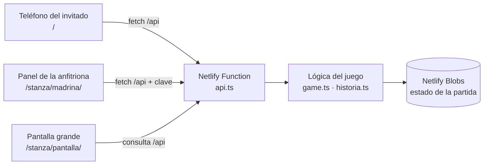

# La Notte di Ninna

Sitio de una fiesta temática de mafia italiana. Reúne dos experiencias en un mismo proyecto:

- **La invitación** (`/invitacion/`), una página editorial con animaciones, música, video y confirmación de asistencia.
- **La Stanza** (`/`), un juego en vivo para los invitados. Se juega desde el teléfono, la anfitriona lo controla desde un panel y una pantalla grande muestra el avance.

El juego, *Il Sigillo Rubato*, divide a los invitados en cinco famiglias que resuelven acertijos, buscan sobres escondidos en la casa y, al final, votan para descubrir al traidor.

## Stack

| Capa | Tecnología |
| --- | --- |
| Frontend | TypeScript, HTML y CSS sin framework, empaquetado con Vite (multi-page) |
| Backend | Netlify Functions v2 (serverless) |
| Persistencia | Netlify Blobs en producción y un archivo JSON local en desarrollo |
| Pruebas | Vitest, chequeo de tipos con `tsc` y un recorrido end-to-end con Node |
| Despliegue | Netlify CLI |

## Arquitectura



El servidor es la única fuente de verdad. Las respuestas, el sorteo del traidor, los puntajes y los tiempos de las pistas se calculan en el backend, y el navegador solo recibe lo que cada rol puede ver. Así el juego no se puede resolver leyendo el código del cliente.

## Funcionalidades

- **Registro por teléfono.** Cada invitado jura por una famiglia y recibe la mitad de una contraseña que comparte con un compañero.
- **Capítulos que abre la anfitriona.** Los acertijos usan cifrado César, una sustitución A=1…Z=26 y preguntas sobre los gustos de la anfitriona, y terminan con un mensaje armado con piezas escritas en espejo.
- **Comparación tolerante de respuestas.** Se ignoran tildes, mayúsculas, puntuación y artículos, y se aceptan errores de tipeo según el largo de la palabra.
- **Pistas automáticas** si ninguna famiglia resuelve un capítulo en 10 minutos, más pistas manuales desde el panel.
- **Rol secreto de traidor**, con misiones que la anfitriona confirma.
- **Votación final secreta** y revelación en la pantalla grande.
- **Panel de control** para abrir capítulos, sortear al traidor, ajustar puntajes, dar pistas y reiniciar la partida.

## Seguridad

- **Respuestas solo en el servidor.** Una prueba falla si algún archivo del cliente importa `historia.ts`.
- **Tokens de invitado.** Se guarda solo su hash (SHA-256), nunca el token.
- **Clave de anfitriona** (`MADRINA_KEY`) como variable de entorno, comparada en tiempo constante.
- **Límite de intentos** al responder, por invitado, y al acceso del panel, por IP, para frenar la fuerza bruta.
- **DOM sin `innerHTML`.** Todo texto entra como nodo de texto, lo que previene XSS.
- **Cabeceras en `netlify.toml`:**
  - Content Security Policy estricta, con un hash para el único script en línea.
  - `X-Frame-Options`, `nosniff`, `Referrer-Policy`, `Permissions-Policy` y `Cross-Origin-Opener-Policy`.

## Estructura

```
.
├── index.html               La Stanza (vista del invitado)
├── invitacion/index.html    Invitación
├── stanza/                  Páginas del juego: invitado, madrina y pantalla
├── src/
│   ├── main.ts, config.ts   Lógica y datos de la invitación
│   └── stanza/              Vistas del juego (guest, madrina, pantalla, ui)
├── netlify/
│   ├── functions/api.ts     API única del juego
│   └── lib/                 Reglas, contenido, normalización, auth, storage y rate limit
├── shared/famiglie.ts       Datos de las famiglias compartidos entre cliente y servidor
├── public/                  Fuentes, ornamentos, escudos y medios
└── tests/                   Pruebas de invitación y juego
```

## Desarrollo local

Requisitos: Node.js en su versión LTS.

```bash
npm install
cp .env.example .env      # define MADRINA_KEY
npm run dev               # http://127.0.0.1:47231
```

En desarrollo, Vite atiende `/api` con el mismo handler de Netlify y guarda el estado en `.stanza-data/`.

```bash
npm test                  # Vitest
npm run typecheck         # tsc --noEmit
npm run build             # genera dist/
npm run e2e               # recorrido completo contra netlify dev
```

## Despliegue

El juego necesita las funciones de Netlify, así que no basta con subir la carpeta `dist`. Hay que publicar con Netlify CLI:

```bash
npm install -g netlify-cli
netlify login
netlify link                                  # o netlify init para un sitio nuevo
netlify env:set MADRINA_KEY "una-frase-larga-y-secreta"
netlify deploy --build --prod
```

## Datos privados

Este repositorio no incluye la lista de invitados ni sus retratos para los carteles «Se busca». `src/stanza/ricercati.ts` explica cómo agregarlos.

## Autora

**Giannina Guerrero** · Desarrolladora Fullstack · Java/Spring · React
[Sitio](https://giannina-guerrero.netlify.app/) · [GitHub](https://github.com/ninnarouge) · [LinkedIn](https://www.linkedin.com/in/ninnaguerrero)
